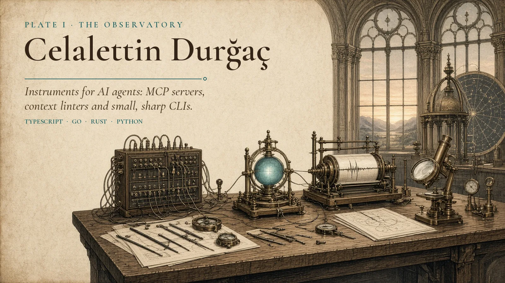
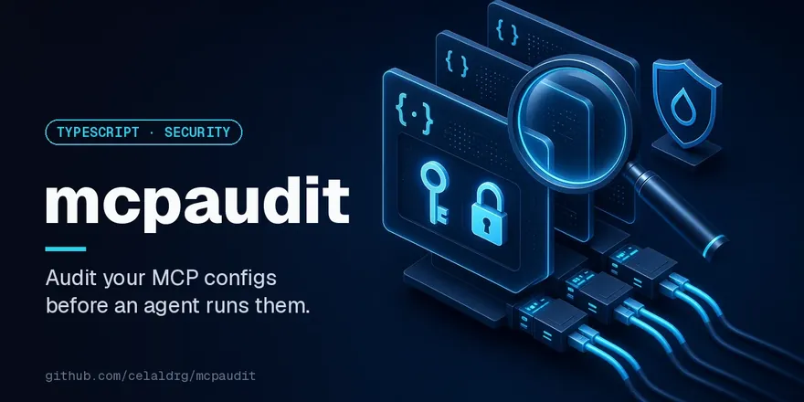
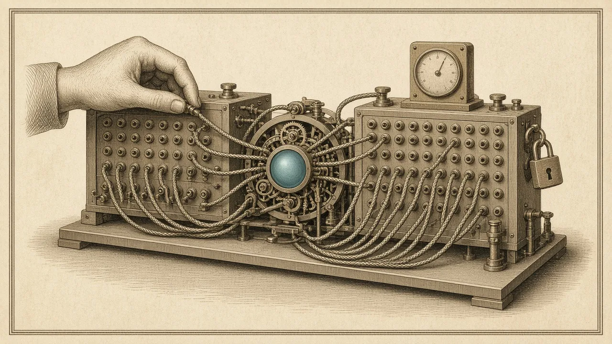
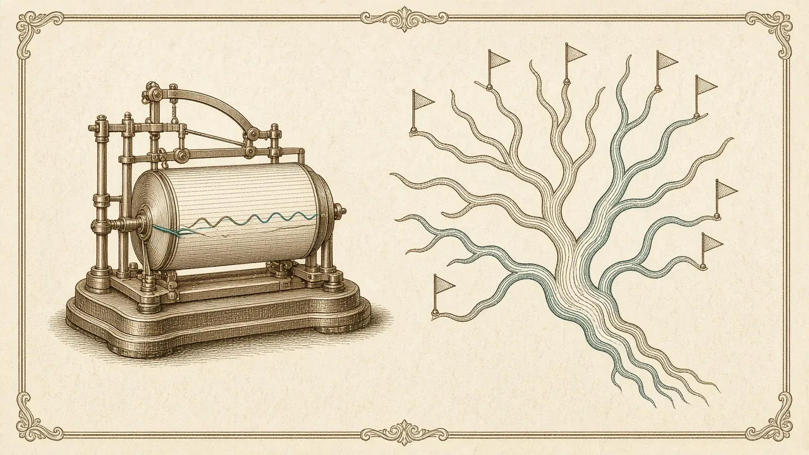

  <picture>
    <source media="(prefers-color-scheme: dark) and (prefers-reduced-motion: reduce)" srcset="assets/frontispiece-dark.webp" />
    <source media="(prefers-color-scheme: dark)" srcset="assets/frontispiece-dark-loop.webp" />
    <source media="(prefers-color-scheme: light)" srcset="assets/frontispiece-light.webp" />
    
  </picture>

  <picture>
    <source media="(prefers-color-scheme: dark)" srcset="assets/header-dark.svg" />
    <source media="(prefers-color-scheme: light)" srcset="assets/header-light.svg" />
    
  </picture>

  Computer programmer and IT specialist 
  <i>Plate I: The Observatory.</i> Instruments for AI agents: MCP servers, context linters and small, sharp CLIs.

  <a href="https://celaldrg.github.io">celaldrg.github.io</a>
  &nbsp;·&nbsp;
  <a href="https://www.linkedin.com/in/celaldrg/">LinkedIn</a>
  &nbsp;·&nbsp;
  <a href="https://github.com/celaldrg?tab=repositories">All repositories</a>

  <b>Plates</b> &nbsp;
  <a href="#ii-the-switchboard">II. The Switchboard</a> ·
  <a href="#iii-the-proofreaders-desk">III. The Proofreader's Desk</a> ·
  <a href="#iv-the-seismograph">IV. The Seismograph</a> ·
  <a href="#v-the-tool-roll">V. The Tool Roll</a>

---

I'm a computer programmer and IT specialist from Türkiye. I build small, sharp developer tools:
MCP servers for AI agents and CLIs that catch problems before they ship. An agent is only as good
as what it is wired to and what it reads every turn, so most of my tools sit at those two seams:
the MCP servers and configs that give an agent its hands, and the instruction files that give it
its context. The rest measure what agents actually do to a codebase, plus the everyday CLIs I
reach for myself. Each one is a single binary or a zero-dependency package, with CI on every push
and real example output in its README.

  

<i>The instruments, in motion:</i> mcpaudit · hooklint · ctxlint · agentprs · turkiye-mcp · mcptax · aiblame · subagentlint

## II. The Switchboard

  <picture>
    <source media="(prefers-color-scheme: dark)" srcset="assets/divider-switchboard-dark.svg" />
    <source media="(prefers-color-scheme: light)" srcset="assets/divider-switchboard-light.svg" />
    
  </picture>

  

<b>Plate II: The Switchboard.</b> Every MCP server is a cable plugged into the agent. These tools check what is on the other end: its config, its schema, its cost in tokens, and whether it is the right one for the job.

| Repository | Language |
|---|---|
| **[mcpaudit](https://github.com/celaldrg/mcpaudit)**: Audit MCP configs (.mcp.json, Cursor, VS Code, Gemini, Claude Desktop) for hardcoded secrets, unpinned npx/uvx/docker servers, plain-HTTP remotes and broken entries. Zero-dep TypeScript CLI + CI gate. | TypeScript |
| **[mcpdiff](https://github.com/celaldrg/mcpdiff)**: Catch breaking changes in MCP server tool schemas: diff two tools/list snapshots, fail CI on breaking changes. Zero-dependency Go CLI. | Go |
| **[mcptax](https://github.com/celaldrg/mcptax)**: What does your MCP server cost an agent's context window? Per-tool token estimates, bloat warnings and a CI budget gate. TypeScript, zero deps. | TypeScript |
| **[toolrank](https://github.com/celaldrg/toolrank)**: Rank MCP tools/list against a natural-language task with keyword heuristics (no LLM) | Go |
| **[turkiye-mcp](https://github.com/celaldrg/turkiye-mcp)**: MCP server for Türkiye: TCMB exchange rates, AFAD/Kandilli earthquakes, holidays & business days, IBAN/TCKN/VKN validation, provinces, prayer times, weather. No API keys. | TypeScript |

## III. The Proofreader's Desk

  <picture>
    <source media="(prefers-color-scheme: dark)" srcset="assets/divider-proofreader-dark.svg" />
    <source media="(prefers-color-scheme: light)" srcset="assets/divider-proofreader-light.svg" />
    
  </picture>

  

<b>Plate III: The Proofreader's Desk.</b> An agent reads its instruction files on every turn, and believes them. These linters proofread those files against the real repo: stale paths, hidden characters, broken links, and pages that weigh too many tokens.

| Repository | Language |
|---|---|
| **[ctxlint](https://github.com/celaldrg/ctxlint)**: Lint AGENTS.md, CLAUDE.md, .cursorrules and copilot-instructions.md against your real repo: stale paths, missing scripts, leaked secrets, token bloat. Zero-dependency Python CLI. | Python |
| **[skillcheck](https://github.com/celaldrg/skillcheck)**: Lint Agent Skills (SKILL.md folders) before Claude Code, Codex, Cursor or Copilot loads them: name and description rules, strict frontmatter, broken file links, context-size warnings. Zero dependencies. | Python |
| **[subagentlint](https://github.com/celaldrg/subagentlint)**: Lint Claude Code subagent files (.claude/agents) before they fail silently: frontmatter typos, missing descriptions, duplicate names, broken hook scripts, description token budget. Zero-dependency Python CLI. | Python |
| **[hooklint](https://github.com/celaldrg/hooklint)**: Lint Claude Code hooks (settings.json, plugin hooks.json) before they silently fail: unknown events, case-sensitive matchers that match nothing, missing scripts, PreToolUse guards that exit 1 and never block. Rust, zero deps. | Rust |
| **[llmslint](https://github.com/celaldrg/llmslint)**: Lint llms.txt files before AI agents read them: structure, links, dead URLs and size, for a file, URL or whole domain. One Go binary. | Go |
| **[invisigrep](https://github.com/celaldrg/invisigrep)**: Find invisible Unicode (zero-width, bidi, tag-char smuggling) that hides prompt injections in AGENTS.md, rules files and code. Zero-dep Go CLI. | Go |
| **[tokmap](https://github.com/celaldrg/tokmap)**: See where your repo's tokens go before an AI agent reads it: a token budget map of files and folders, with lockfile/minified/generated hints and a CI budget check. Rust, zero deps. | Rust |

## IV. The Seismograph

  <picture>
    <source media="(prefers-color-scheme: dark)" srcset="assets/divider-seismograph-dark.svg" />
    <source media="(prefers-color-scheme: light)" srcset="assets/divider-seismograph-light.svg" />
    
  </picture>

  

<b>Plate IV: The Seismograph.</b> Agents now write a real share of the code. The question is what happens to it afterwards. These tools read git history to measure it: who wrote today's lines, how fast agent code gets rewritten, and how agents' pull requests fare.

| Repository | Language |
|---|---|
| **[agentprs](https://github.com/celaldrg/agentprs)**: How do AI agents' pull requests fare in your repo? Share, merge rate and time to merge for Copilot, Claude Code, Codex, Cursor, Devin, Jules & more vs humans. One Go binary, zero deps. | Go |
| **[aiblame](https://github.com/celaldrg/aiblame)**: How much of this repo did AI write? git blame for the agent era: Claude Code, Cursor, Copilot, Codex, Aider, Devin & more. One command, zero deps. | TypeScript |
| **[aichurn](https://github.com/celaldrg/aichurn)**: Does AI-written code get rewritten faster? Two-week churn, copy/paste and moved code from your git history, split by AI-assisted vs human commits. Single Rust binary. | Rust |

## V. The Tool Roll

  <picture>
    <source media="(prefers-color-scheme: dark)" srcset="assets/divider-toolroll-dark.svg" />
    <source media="(prefers-color-scheme: light)" srcset="assets/divider-toolroll-light.svg" />
    
  </picture>

  

<b>Plate V: The Tool Roll.</b> Not every instrument is for agents. Small, single-purpose CLIs for the everyday parts of the job: secrets, env files, lockfiles, certificates, old TODOs, CSVs and Turkish text.

| Repository | Language |
|---|---|
| **[shush](https://github.com/celaldrg/shush)**: Cut the noise from command output before it reaches your AI agent. Errors always kept, full output one call away. MCP server + CLI for any agent. MIT. | TypeScript |
| **[envguard](https://github.com/celaldrg/envguard)**: Catch .env mistakes before they ship: missing keys vs .env.example, broken quotes, duplicates, and real secrets committed to example files. Zero-dependency Python CLI + pre-commit hook. | Python |
| **[lockdiff](https://github.com/celaldrg/lockdiff)**: Readable diffs for lockfiles: what was upgraded, downgraded, added or removed, with major bumps first. npm, pnpm, yarn, Cargo, Go, Poetry, uv, Pipenv, Composer, Bundler. Text, Markdown for PRs, JSON. Zero dependencies. | TypeScript |
| **[certpeek](https://github.com/celaldrg/certpeek)**: Check TLS certificates from the command line: expiry, hostname, trust chain and TLS version for one host or hundreds, with JSON output and exit codes for cron/CI. Single Go binary, stdlib only. | Go |
| **[todoage](https://github.com/celaldrg/todoage)**: How old are your TODOs? Finds TODO/FIXME/HACK comments in a git repo and uses git blame to show who wrote each one and how long ago. Oldest-first table, JSON, CI gate. Fast Rust CLI. | Rust |
| **[csvglance](https://github.com/celaldrg/csvglance)**: Know a CSV before you load it: types, missing values, distinct counts, ranges and top values for every column in one streaming pass. Detects delimiters, gzip, decimal commas. Parallel, single Go binary. | Go |
| **[turkcekit](https://github.com/celaldrg/turkcekit)**: Turkish text done right in Python: correct İ/ı casing, URL slugs, Turkish alphabetical sorting, numbers and lira amounts in words, 1.234,50 ₺ formatting. Zero dependencies, CLI included. | Python |

## Also in the Drawer

- [`awesome-turkiye-dev`](https://github.com/celaldrg/awesome-turkiye-dev): curated resources for developers in Türkiye: open-source projects, Turkish NLP, APIs and open data, communities, events and jobs.
- [`celaldrg.github.io`](https://github.com/celaldrg/celaldrg.github.io): source of my portfolio site, hand-written HTML/CSS with no framework and no JavaScript.

## What I work on

- **Tools for AI agents:** MCP servers that give agents better context with less noise
- **Developer tooling:** small single-binary CLIs that fit into CI, cron and pre-commit
- **Turkish developer ecosystem:** open data, local APIs and curated resources

**On the bench:** `TypeScript` `Python` `Go` `Rust` `JavaScript` `Node.js` `GitHub Actions` `Linux` `Git`

  <picture>
    <source media="(prefers-color-scheme: dark)" srcset="assets/stack-dark.svg" />
    <source media="(prefers-color-scheme: light)" srcset="assets/stack-light.svg" />
    
  </picture>

## The Field Log

  <picture>
    <source media="(prefers-color-scheme: dark)" srcset="https://raw.githubusercontent.com/celaldrg/celaldrg/output/snake-dark.svg" />
    <source media="(prefers-color-scheme: light)" srcset="https://raw.githubusercontent.com/celaldrg/celaldrg/output/snake-light.svg" />
    
  </picture>

Every square is a day at the bench. A small GitHub Action redraws this log each night.

## Contributing

Issues and pull requests are welcome on any of these projects. Issues labeled
[`good first issue`](https://github.com/search?q=user%3Acelaldrg+label%3A%22good+first+issue%22+state%3Aopen&type=issues)
are a good place to start. My own tools are MIT-licensed unless noted; the unofficial editions of other projects keep their upstream licenses.

## Colophon

Five plates, made for this profile and stored in this repo under `assets/`. They are drawn as
engravings from an imaginary observatory-workshop where the instruments serve an automated mind:
a switchboard for its connections, a proofreader's desk for what it reads, a seismograph for what
it leaves behind, and a tool roll for everything else. The frontispiece comes in a day and a night
edition, swapped by `<picture>` to match your GitHub theme. Every caption is repeated as real text
under its plate, because lettering inside an image is lost on a phone and to a screen reader.

The night edition of the frontispiece moves: a six-second loop of the same engraving, with a
still version for anyone who has reduced motion turned on. The name, the typing line and the
section rules are hand-written SVG animations with their fonts embedded. The tool covers in the
slideshow come from each tool's own README. The stack icons are from
[skill-icons](https://github.com/tandpfun/skill-icons) (MIT) and are stored here too. The field
log is drawn from my contribution graph each night by [Platane/snk](https://github.com/Platane/snk)
and published to this repo's `output` branch. No badge services, no counters, no third-party requests.

Türk geliştiriciler için açık kaynak araçlar

